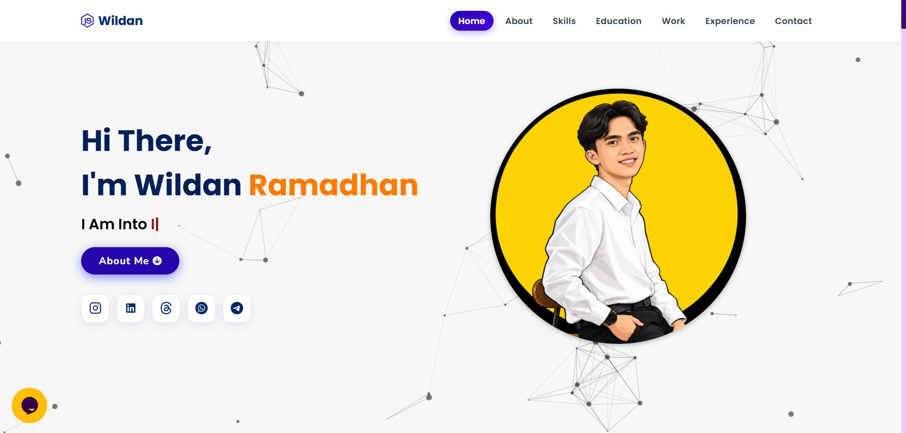

# Wildan Ramadhan — Personal Portfolio Website

Personal portfolio website of **Wildan Ramadhan**, a **Junior Full-Stack Developer & HR Operations Enthusiast** based in Bandung, Indonesia. Built with HTML5, CSS3, JavaScript, and jQuery to showcase web development projects, technical skills, and cross-functional operational experience.

🔗 **Live Website:** [portfolio-wildan.vercel.app](https://portfolio-wildan.vercel.app/)
## 📸 Preview

---

## 📌 Overview & Sections

- **About:** Professional profile highlighting experience in Computer Technology, Laravel web application development, and HR & People Operations, complete with direct Resume access.
- **Skills:** Dynamically loaded technical and operational skill cards powered by `skills.json`.
- **Projects:** Curated portfolio of software and web projects rendered from `projects.json`, including a dedicated `/projects` view.
- **Experience:** Work history across software engineering, HR administration, IT support, purchasing, and warehouse operations (`/experience`).

---

## 🛠️ Tech Stack

[](https://github.com/wildanramadhan-cell/Portfolio-Wildan/search?l=html)
[](https://github.com/wildanramadhan-cell/Portfolio-Wildan/search?l=css)
[](https://github.com/wildanramadhan-cell/Portfolio-Wildan/search?l=javascript)
[](https://jquery.com/)

### Libraries & Tools
`Particle.js` · `Typed.js` · `Tilt.js` · `ScrollReveal` · `Font Awesome` · `JSON`

---

## 📂 Project Structure

```text
Portfolio-Wildan/
├── assets/          # Images, icons, and static media
├── experience/      # Work experience page
├── projects/        # Dedicated projects page & scripts
├── index.html       # Main landing page
├── 404.html         # Custom 404 error page
├── projects.json    # Structured project data
├── skills.json      # Structured skills data
└── README.md        # Project documentation